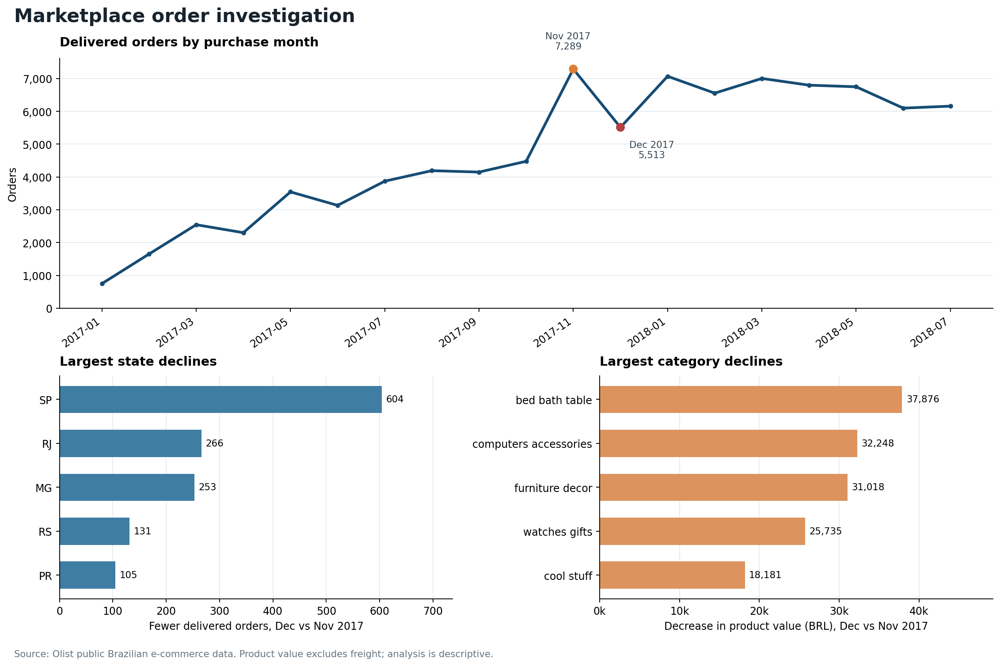

# Marketplace Order Investigation

An independent analysis of historical Brazilian marketplace orders. The project asks a practical business question: **when monthly orders fall, which locations and product categories account for the change?**

The analysis uses Olist's public, anonymized e-commerce data. It covers orders purchased from January 2017 through July 2018 that were ultimately marked as delivered. The largest month-to-month decline in that window occurred between November and December 2017.



## Findings

| Measure | November 2017 | December 2017 | Change |
|---|---:|---:|---:|
| Delivered orders by purchase date | 7,289 | 5,513 | **−1,776 (−24.4%)** |
| Product merchandise value (BRL) | 987,765.37 | 726,033.19 | **−261,732.18 (−26.5%)** |
| Average delivered orders per calendar day | 243.0 | 177.8 | −65.1 per day |

- **A concentrated peak:** 1,147 orders were purchased on 24 November, or 15.7% of that month's delivered orders. Even when that day is removed, the December daily average was 16.0% below the average for the other November days. The data does not identify the cause of the peak.
- **Location:** São Paulo (SP), Rio de Janeiro (RJ) and Minas Gerais (MG) had decreases of 604, 266 and 253 orders. Together, their net decrease was 1,123 orders, equal to 63.2% of the overall net decline.
- **Category:** Bed, bath and table; computers and accessories; and furniture and decor had the largest decreases in product value: BRL 37,876, BRL 32,248 and BRL 31,018 respectively. Category values are additive at item level; they are not counts of distinct orders.

The next investigation would compare promotional calendars, site traffic, product availability, prices and seller participation in the affected states and categories. Those variables are not available in the supplied order files, so the results identify **where to investigate**, not a proven cause or business impact from a change.

## Open the project

- **Excel dashboard:** `outputs/Marketplace_Dashboard.xlsx` contains a linked overview, monthly results, the complete state/category comparisons and daily data. It is a prepared historical snapshot; the workbook does not automatically import refreshed CSVs.
- **One-page case study:** `outputs/Marketplace_Case_Study.pdf` summarizes the problem, results and next questions.
- **SQL:** `sql/01_schema.sql` defines the tables and views. `02`–`07` produce the monthly, location, category, data-quality and daily outputs.
- **Results:** `data/processed/` contains the complete query exports and a `key_metrics.json` file with source-file hashes.
- **Discussion guide:** `docs/INTERVIEW_GUIDE.md` explains the decision points and limitations.

## Reproduce the analysis

Python 3.9+ with SQLite window-function support is sufficient for the main workflow. The five original CSV files are included in `data/raw/`.

```bash
python scripts/run_analysis.py
python -m unittest discover -s tests -v
```

The first command creates `data/olist.sqlite` and overwrites the files in `data/processed/`. The database is generated locally and is not required in the archive. To regenerate the PNG chart, install `matplotlib` separately and run `python scripts/plot_results.py`. To regenerate the PDF, install `reportlab` and run `python scripts/build_case_study.py`. The Excel file is a separate prepared snapshot and is not regenerated by the Python command.

For an optional independent reconciliation against pandas, run `python tests/independent_reconciliation.py` when pandas is available. This compares the November and December order counts and each state/category against a separate dataframe calculation.

## Metric definitions and checks

- **Order population:** one row per order, grouped by purchase month; only orders whose recorded status is `delivered` are counted. Delivery dates are not the grouping date.
- **Analysis period:** January 2017 to July 2018. Earlier and later boundary months are excluded to avoid treating the ends of the snapshot as complete months.
- **Product merchandise value:** sum of item prices for delivered orders, in Brazilian reais. It excludes freight and does **not** represent Olist's platform revenue, profit or take rate.
- **Location:** customer state and city. Every order belongs to one state, so state order changes reconcile to the total order change.
- **Category:** each order item is assigned to its product category. Item value is additive across categories; an order containing different categories can appear in multiple categories.
- **Join safety:** item values are aggregated by order before they are joined to the order-level analysis. Primary keys guard against duplicate orders and duplicate order-item IDs.
- **Missing data:** 1,537 delivered item rows across all available periods lack a usable category and remain in `Unclassified`; they are not silently dropped. Original nonempty Portuguese category names are retained if an English translation is unavailable.
- **Reconciliation:** the analysis checks that monthly totals agree with state, city, daily and category breakdowns. The optional independent check verifies every state and category using a separate pandas calculation.

This dataset is a historical, anonymized snapshot of a Brazilian marketplace. It contains no traffic, advertising spend, inventory or campaign calendar, and findings should not be generalized to Swiggy or current market conditions.

## Data and attribution

Source: **Brazilian E-Commerce Public Dataset by Olist**, published by Olist on [Kaggle](https://www.kaggle.com/datasets/olistbr/brazilian-ecommerce). The included original CSV files were obtained from [Olist's public data repository](https://github.com/olist/work-at-olist-data/tree/master/datasets). Source files and their SHA-256 hashes are recorded in `data/processed/key_metrics.json`.

The dataset is licensed under [CC BY-NC-SA 4.0](https://creativecommons.org/licenses/by-nc-sa/4.0/). This project transforms and aggregates the source data; see `LICENSE.md` for attribution and reuse terms.
